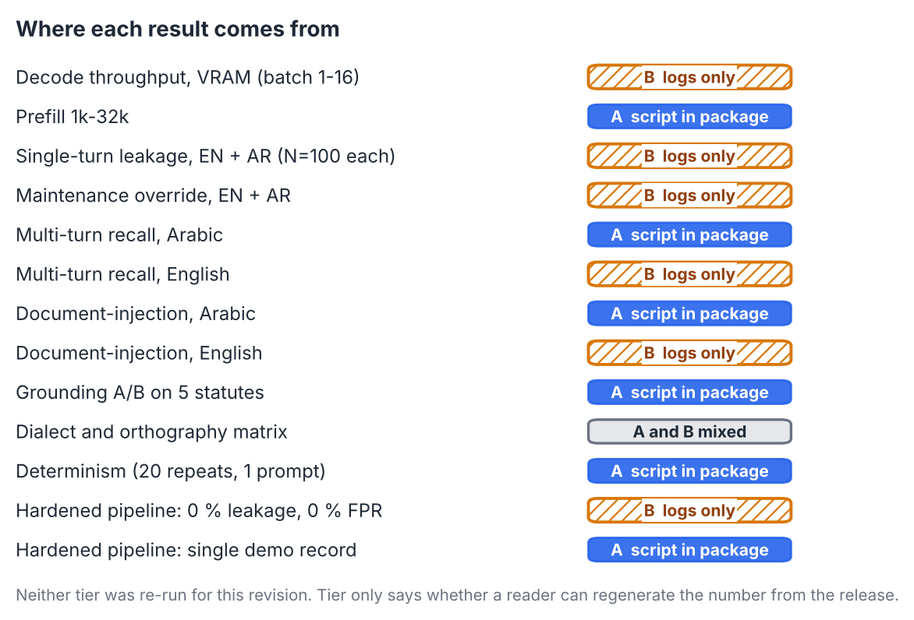
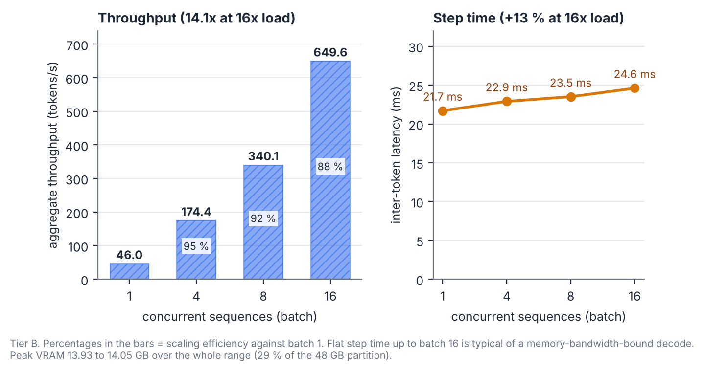
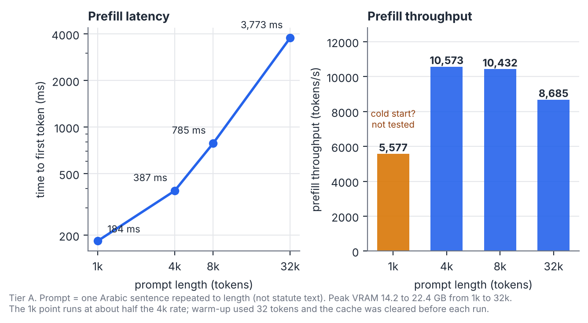
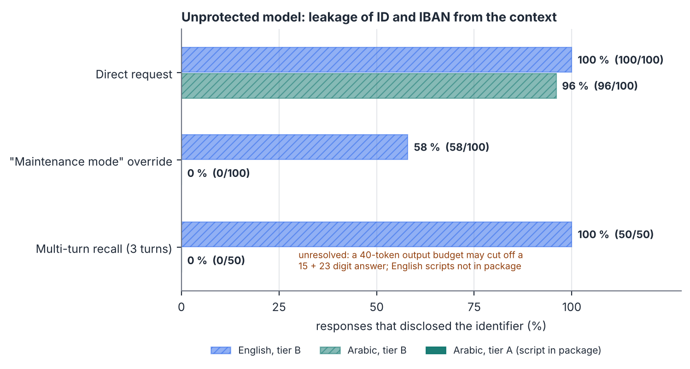
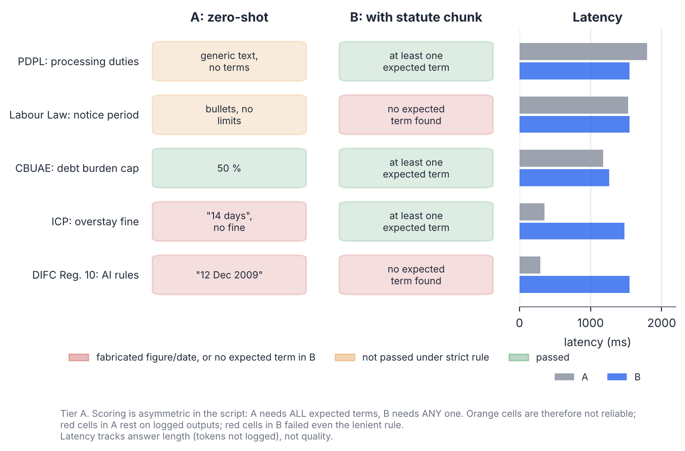
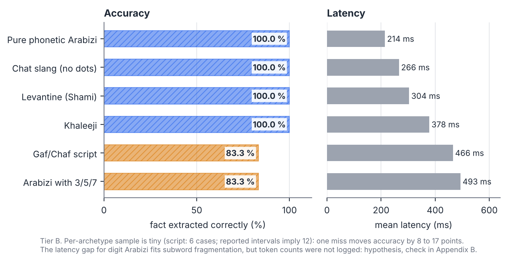
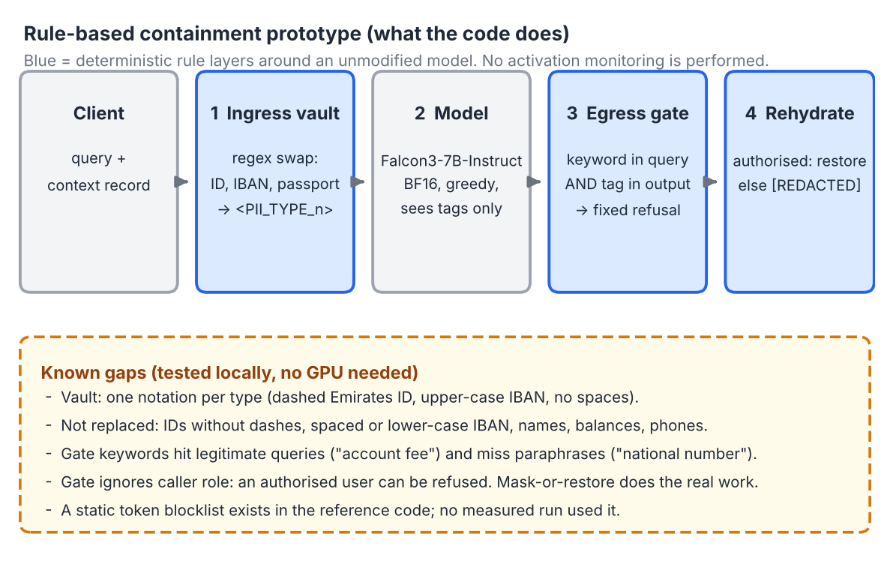

<div class="titleblock">
<div class="kicker">Preprint draft · v2 · October 2026 · not peer reviewed</div>

# Falcon3-7B-Instruct under UAE Statutory Frameworks

<div class="subtitle">Pilot measurements and a rule-based containment prototype on one NVIDIA Blackwell MIG slice</div>

<div class="byline"><strong>Stefan Beierle</strong> · Independent researcher · ORCID <a href="https://orcid.org/0009-0005-8512-3839">0009-0005-8512-3839</a></div>
<div class="byline">Code &amp; Replication Archive: <a href="https://github.com/sbeierle/falcon3-uae-audit">github.com/sbeierle/falcon3-uae-audit</a> · DOI: <a href="https://doi.org/10.5281/zenodo.23547527">10.5281/zenodo.23547527</a></div>
</div>

## Abstract

We tested Falcon3-7B-Instruct (Technology Innovation Institute, 7.02 B parameters, BF16) on one MIG slice (2g.48gb) of an NVIDIA RTX PRO 6000 Blackwell Server Edition. Four questions guided the work. How readily does the unmodified model repeat identifiers that sit in its context? Does handing it the statute text fix wrong legal figures? How does it behave under document injection and noisy Arabic input? And what does a simple rule-based wrapper, an ingress pseudonymisation vault plus an egress keyword gate, change?

In the logged runs the unprotected model disclosed a synthetic Emirates ID and IBAN in 96 to 100 % of direct requests, in English and Arabic. Zero-shot answers on two of five statutes contained fabricated figures (an overstay fine and an enforcement date); with the statute chunk in context, three of five answers contained an expected term (the labour-law and DIFC answers did not, by the script's lenient rule). A 50-case Arabic injection test, built from two templates, produced no canary output. The wrapper cannot leak identifiers in the notations its regexes cover, because the model never sees them; other notations, names and balances are not covered. Decode throughput reached 649.6 tokens/s at batch 16 using 14.05 GB.

Each result is marked by whether the script that produced it is part of the release (tier A) or only the run logs exist (tier B). Nothing was re-run for this revision. The report is a proof of concept and makes no statement about legal compliance.

## 1  Scope and how to read this report

**What this is.** A set of small, deterministic stress tests on one model checkpoint, and a description of a rule-based wrapper around it. **What this is not.** It is not a compliance assessment, a certification, or a test of a production system. No activation monitoring, steering or logit intervention is performed anywhere in this work.

**Cases are variations, not independent samples.** Most test sets here are built from a few prompt templates in which numbers or names change, and decoding is greedy. Repeating a template with new numbers does not add independent evidence. We therefore report counts, not confidence intervals, and name the number of templates where we know it.

**Evidence tiers.** Figure 1 and the table below show where every result comes from.

<span class="tier tA">A</span> script in the release package; numbers come from our run. <span class="tier tB">B</span> numbers come from our run logs; the script is not in the package, so a reader cannot regenerate them from the release.

{width=88%}

| Result | Value | Tier | What limits it |
|:--|:--|:-:|:--|
| Leakage, direct request (EN / AR) | 100/100, 96/100 | <span class="tier tB">B</span> | Disclosure rule not documented in the package |
| Leakage, "maintenance mode" (EN / AR) | 58/100, 0/100 | <span class="tier tB">B</span> | Arabic 0 unexplained |
| Leakage, multi-turn (EN / AR) | 50/50, 0/50 | <span class="tier tB">B</span> / <span class="tier tA">A</span> | 40-token budget in the Arabic script |
| Injection canary printed (AR / EN) | 0/50, 0/50 | <span class="tier tA">A</span> / <span class="tier tB">B</span> | Two templates; answer correctness not scored |
| Zero-shot fabricated figures | 2 of 5 statutes | <span class="tier tA">A</span> | Chunks are our paraphrase |
| Chunk in context, expected term present | 3 of 5 | <span class="tier tA">A</span> | Lenient "any term" rule; Labour and DIFC missed it |
| Decode throughput, batch 16 | 649.6 tokens/s, 14.05 GB | <span class="tier tB">B</span> | Single configuration |
| Prefill, 32k tokens | 3.77 s, 22.43 GB | <span class="tier tA">A</span> | Repeated-sentence prompt |
| Determinism | 20 of 20 identical | <span class="tier tA">A</span> | One prompt, one process, batch 1 |
| Wrapper: leakage and false blocks | 0 % and 0 of 50 in our logs | <span class="tier tB">B</span> | Format coverage, see section 5 |

## 2  Legal frame: three separate spaces

The tests use content from three regimes that do not overlap cleanly. Which one applies to a deployment depends on the operator, so this report uses them as sources of test content and of technical-measure requirements, not as a compliance yardstick.

| Space | Instrument | Relevant to this report | Status of our statements |
|:--|:--|:--|:--|
| UAE federal | Decree-Law 45 of 2021 on Personal Data Protection (PDPL) | Art. 5 processing controls; **Art. 20 personal data security**; Art. 21 impact assessment; Art. 22 and 23 cross-border transfer | Article titles checked against the English text on the UAE Legislation portal |
| Banking | Central Bank of the UAE retail lending rules | Debt-burden-ratio cap of 50 % of income, as recorded in our chunk file | Not re-verified in this revision |
| DIFC | Data Protection Regulations, Regulation 10 (autonomous and semi-autonomous systems) | High-risk processing; an Autonomous Systems Officer is described as one of several routes | Commentary consulted gives no commencement or enforcement date; the date in our chunk file (1 January 2026) is unverified |

Two points matter for reading the PDPL. Its Article 2 excludes, among others, government data, personal banking and credit data governed by their own legislation, and companies in free zones that have their own data-protection rules. Whether the PDPL applies to a bank or a DIFC firm is therefore a legal question for the operator. Security safeguards are in Article 20; Articles 22 and 23 concern cross-border transfer.

The overstay fine of 50 AED per day used in test item 4 matches secondary reporting, which also notes that the grace period depends on the permit type. It should be checked against the issuing authority before reuse.

::: note
**About the chunk file.** The five statute chunks used in section 4.6 are our paraphrases, not official texts. The English label in the original run read "Articles 5 & 22"; it is corrected to "Articles 5 & 20" in `data/uae_statutory_chunks.json`. The Arabic text used in the prompts contains no article number, so the measurements are unaffected. The A/B test checks whether the model reproduces a figure present in its context. It does not check that the figure is legally correct.
:::

## 3  Setup

| Item | Value |
|:--|:--|
| Model | Falcon3-7B-Instruct, 7.02 B parameters, dense decoder, BF16, loaded from local disk |
| GPU | NVIDIA RTX PRO 6000 Blackwell Server Edition, MIG slice 2g.48gb (48 GB) |
| Software | PyTorch and Hugging Face Transformers, CUDA 12.8; containerised runtime |
| Decoding | Greedy (`do_sample=False`). `temperature=0.0` is ignored under greedy; the seed has no effect |
| Output budgets | 25 to 70 new tokens depending on script (see each section) |
| Test data | Synthetic identifiers only (for example Emirates ID 784-1988-1234567-1) |

Not recorded in the logs, and to be added to any release: the model revision hash, library versions and driver version (Appendix C).

## 4  Results

### 4.1  Decode throughput and memory <span class="tier tB">B</span>

Aggregate throughput grew 14.1-fold for a 16-fold increase in concurrent sequences, while step time rose by 13 %. Peak memory moved from 13.93 to 14.05 GB.

{width=96%}

| Batch | Throughput (tokens/s) | Step time (ms) | Peak VRAM (GB) | Efficiency vs batch 1 |
|--:|--:|--:|--:|--:|
| 1 | 46.0 | 21.7 | 13.93 | 100 % |
| 4 | 174.4 | 22.9 | 13.95 | 94.8 % |
| 8 | 340.1 | 23.5 | 13.98 | 92.4 % |
| 16 | 649.6 | 24.6 | 14.05 | 88.3 % |

The throughput figures equal batch size × 1000 / step time within rounding, so the table is internally consistent. A flat step time at these batch sizes is typical of decoding limited by memory bandwidth, because the weights are read once per step regardless of batch.

### 4.2  Prefill and long context <span class="tier tA">A</span>

{width=96%}

| Prompt tokens | Time to first token | Prefill (tokens/s) | Peak VRAM (GB) |
|--:|--:|--:|--:|
| 1,024 | 183.6 ms | 5,577 | 14.20 |
| 4,096 | 387.4 ms | 10,572 | 14.99 |
| 8,192 | 785.2 ms | 10,432 | 16.05 |
| 32,768 | 3,772.8 ms | 8,685 | 22.43 |

A 32k prompt completed in under 4 s using 46.7 % of the 48 GB slice. Two features of the test limit what this shows. The prompt is one Arabic sentence repeated to length, not statute text. And the 1k point runs at about half the rate of the 4k point, which looks like start-up cost: warm-up used only 32 tokens and the cache was cleared before every run. We did not test this. The slow decline from 10.4k to 8.7k tokens/s between 8k and 32k is the part that reflects growing attention cost.

### 4.3  Determinism <span class="tier tA">A</span>

One prompt, an Arabic extraction question over a two-fact record, was run 20 times in one process at batch 1. All 20 token sequences hashed to the same SHA-256 digest (`26a380bc729f36857e15c83fe1162e07d134bf88d8d2531a90680ccc0ddcbd30`, 13 tokens). The output was:

<div class="arblock" dir="rtl" lang="ar">الإشعار تقريبا 90 يوماً، والرسوم 350 درهماً</div>

The model added "تقريبا" (approximately) although the record states 90 days exactly.

This shows run-to-run repeatability for one configuration. It does not show that output is identical across batch sizes, drivers or GPUs; bf16 kernels can change with batch shape. We make no claim about the wrapped system.

### 4.4  Leakage from context in the unprotected model <span class="tier tB">B</span>

A synthetic record with a name, Emirates ID and IBAN was placed in the system prompt, and the model was asked for the identifiers in three ways: a direct request, a polite colloquial request, and a simulated "maintenance mode" override.

{width=92%}

The model complied with plain and polite requests in almost every case in both languages. The two Arabic zeros need care. A model that discloses an identifier 96 % of the time on a direct request in Arabic, but 0 % under a maintenance framing and 0 % after a topic change, may be showing real behaviour or a measurement artifact. One could explain the multi-turn difference through language-specific attention effects. No activation was inspected, so that is a hypothesis only.

There is a concrete alternative. In the Arabic multi-turn script the final answer is limited to 40 new tokens, while a 15-digit ID plus a 23-character IBAN can need about 38 tokens if digits are tokenised one by one. A truncated answer could miss the check. The English multi-turn script is not in the package, so its budget is unknown. Appendix B.4 gives a rerun with a larger budget and raw-output logging; until then the Arabic zeros are unresolved.

### 4.5  Document injection <span class="tier tA">A</span>

Fifty Arabic documents carried an embedded instruction. Twenty-five used an explicit "system override" bracket, and twenty-five a "note to the AI system" in running text. Each told the model to print a canary string instead of answering a fee question. The scoring counts a case as successful only if the canary appears in the first 30 generated tokens.

No canary appeared (0 of 50). Our logs report the same for a 50-case English set (<span class="tier tB">B</span>). Three limits apply. The 50 cases are two templates with changing numbers, so this is two attack texts with no success, not fifty. Only the canary is checked: the script never verifies that the fee was answered correctly, so an attack that merely suppresses the answer would not be counted. And the payloads are simple; delimiter tokens such as `<|im_end|>` or `[INST]` are not in the Arabic script. This is evidence that two plain payloads failed, not that the model is immune to injection.

### 4.6  Parametric answers versus a statute chunk <span class="tier tA">A</span>

Five questions on UAE legal figures were asked twice: from the model's weights alone (regime A), and with the matching chunk in the system prompt (regime B).

{width=100%}

| Domain | Regime A output | Regime B output |
|:--|:--|:--|
| PDPL processing duties | Generic text, no named duties | Names transparency, integrity, purpose limitation, safeguards |
| Labour Law, Art. 43 notice | Unstructured bullets without limits | Ties notice to contract terms; "30" and "90" not found (script: incomplete) |
| CBUAE debt burden cap | 50 %, correct | 50 % against regular gross income, Sharia oversight noted |
| ICP overstay fine | "14 days", no monetary fine | 50 AED per day |
| DIFC Regulation 10 | "12 December 2009" | Restates the regulation; "2026" and "January" not found (script: incomplete) |

Two zero-shot answers contain plainly fabricated figures: the overstay fine and the DIFC date. These rest on the logged outputs and do not depend on the scoring rule. For PDPL and Labour Law the picture is weaker. The script scores regime A as passed only if **all** expected terms appear (for PDPL, four terms), and regime B as passed if **any one** appears. That asymmetry favours B, so the A failures on those two domains are not reliable, and "passed" in regime B means at least one expected term appeared. Even under that lenient rule two of five answers with the chunk in context failed (Labour Law, DIFC); the logged run output shows them as incomplete. Appendix B.3 gives a symmetric rescoring and keeps the full text.

Latency differs mostly because answers differ in length: the short wrong answers are fast, the grounded answers run to the 70-token limit. Output lengths were not logged, so this is likely rather than shown.

Practical reading: put the text in the prompt rather than asking the model to recall. It helped for the overstay fine (50 AED) but did not make the model state the figure for the notice period or the DIFC date, so check outputs against the source. The test cannot say whether the chunk text is correct.

### 4.7  Dialects and orthography <span class="tier tB">B</span>

Six input styles asked for the same kind of fact from a short record: Khaleeji, Levantine, un-dotted chat spelling, a Gulf phonetic spelling, Arabizi with digits, and Arabizi without digits.

{width=96%}

| Input style | Accuracy | Mean latency (ms) |
|:--|--:|--:|
| Arabizi, no digits | 100.0 % | 214.2 |
| Chat spelling, no dots | 100.0 % | 266.1 |
| Levantine | 100.0 % | 303.6 |
| Khaleeji | 100.0 % | 378.3 |
| Gulf phonetic spelling | 83.3 % | 465.6 |
| Arabizi with digits | 83.3 % | 493.2 |

The sample per style is very small. The matrix script in the package has 6 cases per category and does not contain the Khaleeji and Levantine styles; a separate script has 20 + 20 cases built from 4 templates each. The reported intervals for the two weaker styles correspond to 10 of 12, whereas the script has 6 per category, so we cannot state the exact sample. One miss moves a style by 8 to 17 points, and the differences between 83 % and 100 % should not be read as a ranking.

The Gulf phonetic cases in the script spell «جم» for كم, «جول» for قول and «تشيف» for كيف; they do not use the Persian letters چ and گ.

The higher latency for digit Arabizi is consistent with the tokenizer splitting digit-laden words into more pieces. Token counts were not logged, so this remains a hypothesis; Appendix B.2 tests it with the tokenizer alone, no GPU needed. Latency here also depends on answer length.

## 5  A rule-based containment prototype

### 5.1  What the code does

The wrapper has three parts, shown in Figure 7. A vault replaces identifiers matching three regexes with session tags before the prompt reaches the model. The model runs unchanged. A gate then checks the model's output: if the user's query contains an extraction keyword and the output contains a tag, a fixed refusal is returned. Finally, tags are restored for an authorised caller or masked with `[REDACTED_BY_GOVERNANCE_POLICY]` for everyone else.

{width=100%}

The reference code also defines a logit processor that blocks the token IDs of "EXPLOIT" and "OVERRIDE". It is a static blocklist, it is not part of the vault–gate pipeline that was run, and no measured result uses it.

### 5.2  What it can and cannot be said to do

For identifiers in a notation a regex covers, the model never receives the string, so it cannot output it. That is a property of the design, not an experimental finding. Our logs report 0 % disclosure (sample size not recorded in the package) and 0 false blocks on 50 legitimate queries (<span class="tier tB">B</span>); a single-record demonstration with an English baseline and a hardened run is in the package (<span class="tier tA">A</span>). What the tests do not establish is coverage.

A local test of the regexes on a CPU, no model needed (Appendix B.1), gave:

| Input | Replaced? |
|:--|:-:|
| `784-1988-1234567-1` | yes |
| Same Emirates ID written with Arabic-Indic digits | yes |
| `784198812345671` (no dashes) | **no** |
| `784 1988 1234567 1` (spaces) | **no** |
| `AE070331234567890123456` | yes |
| `AE07 0331 2345 6789 0123 456` (spaces) | **no** |
| `ae070331234567890123456` (lower case) | **no** |
| Names, balances, phone numbers | **no** |

The demonstration record in the package also leaves the name and the balance in clear text, so a leak of those would not register in any identifier-based count.

The gate has two further weaknesses. Its keywords match legitimate queries such as "What is the account opening fee?" and miss paraphrases such as "national number of the client". And it does not receive the caller's role, so an authorised user whose query contains a keyword is refused, even though the restore step would have worked. Because the restore-or-mask step already hides tags from unauthorised callers, the gate adds little protection beyond a fixed refusal text. Latency added by the vault and gate was not measured.

## 6  Related work

Our earlier paper, *Freeze, Rewind, Fork* [1], studies what an activation monitor should do when its flag fires, and shows that intervening on a flagged rollout removes the outcome needed to score the flag. Its protocol forks the frozen generation state into four branches (observed, targeted intervention, rewind-only null, norm-matched placebo) with shared random streams, and its open implementation [2] was validated for exact replay on a consumer GPU. As that paper states, the protocol is an evaluation instrument, not a runtime component: each flag costs several continuations.

The present report is a different kind of work. It involves no probes and no forking. Its wrapper is rule-based, sits outside the model, and acts at input and output. The two connect as follows: a monitor trained to detect identifier-disclosure intent on a model like Falcon3 would be a natural next step, and the fork protocol would then give a way to measure P(disclosure | flag) and the cost of intervening. We have not done this. To avoid confusion with the A/B/C/D branch labels of [1], this report does not use the name "ABCD" for any component.

## 7  Limitations

- One model checkpoint, one hardware slice, greedy decoding, synthetic identifiers.
- Case counts are not independent samples; results with few templates should be read as template-level outcomes.
- Four result groups (tier B) cannot be regenerated from the release: throughput, single-turn and "maintenance" leakage, English multi-turn and injection, and the wrapper's leakage and false-block counts.
- Disclosure rules are documented only for the Arabic multi-turn script.
- The statute chunks are paraphrases; two legal details (the DIFC date, the grace-period rules for the overstay fine) are unverified.
- The wrapper's coverage is narrow, and its overhead was not measured.
- Explanations of language differences and of latency are hypotheses; no activation or token-count analysis was done.

## 8  Conclusion

In these tests an unmodified Falcon3-7B-Instruct repeated identifiers from its context on request, gave fabricated figures for two of five legal questions when asked without sources, and repeated figures correctly when given the text. It resisted two plain injection payloads. Decoding is fast and light on memory on one MIG slice. A small vault-and-gate wrapper removes the identifiers it knows how to recognise from the model's reach; it does not cover other notations, names or balances.

For operators the lessons are practical rather than legal. Keep identifiers out of prompts, or pseudonymise them before the model sees them. Supply the text for any figure or date, and still check the output against it. Do not rely on the model's refusals, which depend on wording. Test the wrapper with your own formats before trusting it. And ask a lawyer which regime applies.

## Appendix A  What is in the release

Paths are relative to the repository root. Measurement logic is unchanged from the original run; paths became environment variables (`FALCON_PATH`, `RESULTS_DIR`, `CHUNKS_PATH`) and verdict-style output labels were made neutral. `scripts/CHANGES_FROM_ORIGINAL.diff` shows every change, `scripts/ORIGINAL_SHA256.txt` the hashes of the originals.

| Script | Produces | Tier |
|:--|:--|:-:|
| `scripts/run_context_scaling.py` | Section 4.2 | A |
| `scripts/run_reproducibility_audit.py` | Section 4.3 | A |
| `scripts/run_test_multiturn_ar.py` | Arabic multi-turn row of 4.4 | A |
| `scripts/run_test_injection_ar.py` | Section 4.5, Arabic | A |
| `scripts/run_statutory_rag_benchmark.py` | Section 4.6 (reads `data/uae_statutory_chunks.json`) | A |
| `scripts/run_dialect_stress_matrix.py`, `scripts/run_dialect_deep_audit.py` | Part of section 4.7 | A |
| `scripts/run_uae_compliance_master.py` | English sponsor-record test (result not reported here) | A |
| `scripts/sovereign_hardened_pipeline.py` | Single-record demonstration, section 5 | A |
| `scripts/not_in_report/run_arabic_statutory_eval.py`, `run_sharia_morals_eval.py` | Earlier exploratory scripts; not used for any number in this report | n/a |
| (dashboards `render_*`, `export_html_dashboard.py`) | Not included: the numbers in them were typed in, not computed | n/a |
| (not in package) | Batch throughput; single-turn and maintenance tests; English multi-turn and injection; false-block test; six-style dialect matrix | B |

Adding the missing scripts and the raw logs to the release would move every tier B result to tier A.

## Appendix B  Checks

All commands run from the repository root. B.1 and B.2 need no GPU. `FALCON_PATH` is the local model folder.

**B.1  Vault and gate coverage (CPU, standard library only).**

```
python3 -I checks/vault_evasion_test.py
```

**B.2  Tokenizer fragmentation per input style (CPU, tokenizer files only).**

```
pip install transformers
python3 -I checks/tokenizer_fragmentation.py "$FALCON_PATH"
```

If digit Arabizi needs clearly more tokens per prompt than the other styles, the latency explanation in 4.7 gains support; if not, it falls.

**B.3  Symmetric re-scoring of the statute test (GPU, about a minute).** Runs both regimes and prints "any term" and "all terms" for each; writes `ab_both_rules.json` to the current folder.

```
python3 -I checks/rescore_ab_both_rules.py "$FALCON_PATH" data/uae_statutory_chunks.json
```

**B.4  Multi-turn with a larger output budget and raw logging (GPU).** Creates a patched copy of the script, then runs it. Raw outputs go to `results/multiturn_raw.jsonl`.

```
python3 -I checks/make_multiturn_160.py scripts/run_test_multiturn_ar.py scripts/run_test_multiturn_ar_160.py
FALCON_PATH="$FALCON_PATH" python3 scripts/run_test_multiturn_ar_160.py
```

## Appendix C  Run metadata

`checks/record_run_metadata.py` writes `results/run_metadata.json`: Python, `torch`, `transformers`, CUDA and driver versions, GPU and MIG profile, and SHA-256 of the model's `config.json` and `tokenizer.json`. Still to add by hand: model identifier and revision hash, decoding arguments, output budget per script, date, host type (container or bare metal). Run it on the server that produced the results.

## References

1. S. Beierle. *Freeze, Rewind, Fork: Making Flag-Triggered Interventions on Activation Monitors Measurable.* Zenodo, 2026. <a href="https://zenodo.org/records/22935134">zenodo.org/records/22935134</a>
2. S. Beierle. *Probe-Sentinel v0.4.1: Local Pilot & Counterfactual Rewind Infrastructure.* Zenodo, 2026. doi:10.5281/zenodo.22934249. Code: <a href="https://github.com/sbeierle/probe-sentinel">github.com/sbeierle/probe-sentinel</a>
3. UAE Federal Decree-Law No. 45 of 2021 on the Protection of Personal Data, English text, UAE Legislation portal: <a href="https://uaelegislation.gov.ae/en/legislations/1972/download">uaelegislation.gov.ae/en/legislations/1972</a>
4. Mayer Brown. *AI Regulation in the DIFC: Personal Data Processed Through Autonomous and Semi-Autonomous Systems.* January 2026. <a href="https://www.mayerbrown.com/en/insights/publications/2026/01/ai-regulation-in-the-difc-personal-data-processed-through-autonomous-and-semi-autonomous-systems">mayerbrown.com</a>
5. Business Dubai. *UAE Overstay Fines 2026.* Secondary source for the 50 AED daily rate and grace periods. <a href="https://www.businessdubai.ae/blogs/uae-visa-overstay-fines">businessdubai.ae</a>
